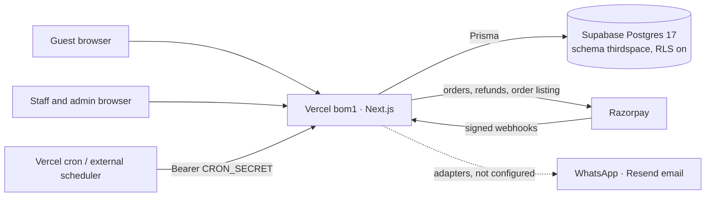

# System architecture

Status of this document: describes what is **implemented** in the repository (commit history on branch `claude/intelligent-ride-aojomq`). Items marked *Not built* are not in the code.

## Shape

One Next.js 16 application (App Router, React 19, TypeScript, Tailwind 4) in `third-space/`: a modular monolith. Pages, server actions and API routes live in one deployable. The older Next.js app at the repository root is separate and untouched.

## Modules

| Module | Location | Responsibility |
|---|---|---|
| Public site | `src/app/(site)/*`, `src/components/site-*` | Marketing, pricing, policies, SEO pages |
| Booking flow | `(site)/book`, `src/app/api/{availability,calendar,holds,checkout,coupons,otp}` | Availability, holds, checkout |
| Slot engine | `src/server/slots/*` | Free slots, buffers, closures, shared assets, locks, booking creation, payment confirmation |
| Payments | `src/server/{payments,refunds,reconcile}.ts`, `api/webhooks/razorpay` | Razorpay orders, signature, webhook, refunds, reconciliation |
| Credits | `src/server/credits.ts` | Append-only credit ledger |
| Customer portal | `src/server/{customer-auth,customer-actions,reschedule,feedback-actions,guest-actions}.ts`, `(site)/account`, `(site)/my-booking` | Accounts, password reset, history, reschedule, cancel, feedback |
| Admin | `src/app/admin/(panel)/*`, `src/server/admin/*` | Bookings, calendar, schedule, catalogue, CRM, reports, settings, staff, audit |
| Staff portal | `src/app/staff/*`, `src/server/staff-actions.ts` | Daily schedule, check-in, room ready, notes, issues |
| Platform | `audit.ts`, `rate-limit.ts`, `notify.ts`, `otp.ts`, `booking-state.ts`, `src/lib/money.ts` | Audit log, rate limits, notification outbox, OTP, state guard, money |

## Key rules

- **Money** is integer paise everywhere (`src/lib/money.ts`). Conversion happens only at the edges: config literals (`rs()`), admin form input (`parseRupees`), display (`formatINR`).
- **Time** is stored as UTC `timestamp(3)`; business time is Asia/Kolkata (fixed +05:30, no DST) via `src/server/slots/time.ts`. *Not built:* `timestamptz` column type (see ASSUMPTIONS_AND_DECISIONS).
- **Server decides.** Availability, session length and price are recomputed on the server at hold and checkout; the browser's numbers are never trusted.
- **Catalogue in the database.** Packages, add-ons, coupons, resources and business settings are Postgres rows with a 30-second cache and seed values in `src/config` as fallback. Availability and payment state are never cached.
- **Environments.** One database (production). Preview builds do not run migrations (`scripts/vercel-build.mjs`) but still read the production database. *Not built:* a staging database.

## Authentication

| Actor | Mechanism |
|---|---|
| Staff and admin | Email and scrypt-hashed password (`StaffUser`), or the bootstrap owner login (`ADMIN_PASSWORD`). HMAC-signed httpOnly `SameSite=Strict` cookie, active flag checked on every request. 5 roles, permission table in `src/server/admin/auth.ts`. |
| Customers | Mobile or email and scrypt password. HMAC-signed httpOnly `SameSite=Lax` cookie with `iat`; password change or reset sets `Customer.sessionsValidFrom`, which rejects older cookies. |
| Guests without account | Booking ID plus a private access token, or ID plus phone plus email for lookup. |

## Not built (honest list)

Staging database; tested backup restore; error monitoring and uptime alerting; WhatsApp, email and SMS delivery (adapters exist, no provider connected); online payments in production (no Razorpay keys); invoices; GST invoice numbering; 8-role model; separate calendars UI per space beyond the schedule view; a Report 11 / Report 12 based design (document missing).
