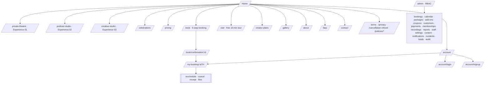

# Perfect Venue → THIRD SPACE: Design-system and UI/UX audit

**Audit date:** 2026-11-20.
**Reference:** https://www.perfectvenue.com/ (public marketing site).
**Target:** THIRD SPACE, by LovBites Hospitality Group, Dhanbad, Jharkhand.

**How the audit was done:**
- Headless Chromium (Playwright) loaded the live pages with their real CSS.
- Values were read with `getComputedStyle`, so every number marked **M** (measured) comes from the browser.
- Values marked **E** are estimates read off screenshots.
- No private code, backend, database or design files were accessed. Perfect Venue's images and logos are not copied into this repository.

**Evidence:**
- Full-page captures at 4 viewports (desktop, laptop, tablet, mobile) for 29 page templates, 116 images in total.
- They are referenced below as `pv-<viewport>-<page>.jpg`, for example `pv-desktop-pricing.jpg`.
- They were kept out of git on purpose. Regenerate them with the scripts in `docs/audit/tools/`:
  - `crawl.js`: structure of all pages
  - `tokens.js`: computed design tokens
  - `shots.js`: screenshots
  - `ix.js`: interactions
- `docs/audit/tools/crawl-results.json` holds the raw crawl of 166 pages.
- THIRD SPACE captures of the rebuilt site are in `docs/audit/screens/ts-*.jpg`.

---

## DOCUMENT 01: Executive summary

**What Perfect Venue (PV) is**
- A B2B SaaS marketing site (Webflow) for restaurant and venue event software.
- Every page drives towards two conversions: **Start Free Trial**, which goes to `app.perfectvenue.com/users/sign_up`, and **Request/Book a Demo** (`/demo-request`, a HubSpot form and a Calendly link).

**Coverage**
- The sitemap lists 680 URLs: 526 blog posts and 154 other pages.
- All 154 non-post pages were crawled, plus a sample of 12 blog posts, which share one template. That is 166 pages; every one returned HTTP 200.

**What PV does well, and THIRD SPACE adopts**
1. **One clear CTA pair everywhere.**
   - An outline button paired with a filled button, in the nav and in the hero.
   - 134 of 166 pages repeat the same nav CTAs.
2. **Alternating section bands.** White → navy `#3B396C` → ivory `#F7F0ED` → coral `#FE6257` give rhythm on long pages without imagery.
3. **A serif display face plus a geometric sans for UI.** Measured: Gazpacho for display and Circular for UI.
4. **Social proof next to decisions.** Testimonial cards, rating chips and a 4-slide testimonial slider all sit near pricing and the CTAs.
5. **Pricing page anatomy.**
   - Billing toggle.
   - Three plan cards with a "Most popular" ribbon.
   - Full feature comparison table.
   - Guarantee pill, then FAQ.
6. **A repeated "Want a taste test?" split block.** An image beside a demo form, repeated on the high-intent pages.

**Where PV falls short, and THIRD SPACE avoids it** (details in DOCUMENT 13)
- 10 homepage blocks start at `opacity:0` until JavaScript runs, so content is invisible without JS.
- 12 CTAs labelled "Book a Demo" actually go to the sign-up page.
- 8 CTAs point to the broken anchor `#https://app…`.
- 5 "Sign up" links go to `#`.
- Key pages have no `<h1>`: /demo-request, /contact-us, /ai-reply, /privacy-policy, /terms-of-service.
- FAQ answers are always expanded rather than in an accordion. That suits SEO, but the section is long.
- 10 font families are loaded and only 3 are used.
- Horizontal overflow at 768px on /, /blog and /free-beo-template.
- On mobile, tag and category H1s stay at 50px (no step down).
- The mobile menu overlay measured 16,010px tall.

**What was built for THIRD SPACE**
- An original cinematic identity: midnight black, espresso, champagne gold and warm ivory.
- Perfect Venue's structural ideas were adopted; none of its assets or styling were copied.
- New and updated pages:
  - `/pricing` with cards, a comparison table, add-ons and notes
  - `/creative-studio` (Experience 03)
  - Restructured home
  - Customer accounts: `/account`, `/account/login`, `/account/signup`
  - Self-service rescheduling
  - Ivory and gold section bands, button scale and icon containers
- All booking, payment and calendar functions are live and covered by 57 passing end-to-end tests.

---

## DOCUMENT 02: Complete website sitemap (public)

```mermaid
flowchart TD
  H[/ Home/] --> AI[/ai-reply/]
  H --> F[/features/]
  H --> P[/pricing/]
  H --> T[/customer-success · Testimonials/]
  H --> RM((ratemyeventspage.com · external))
  H --> LI((app.perfectvenue.com · Log in, auth))
  H --> DR[/demo-request/] --> DRS[/demo-request-success/]
  H --> FT[/free-trial/] -->|302| SU((app…/users/sign_up · auth))
  T --> CS[/customer-spotlight/* ×34/]
  F --> BEO[/free-beo-template/] --> BEOS[/success-beo-download/]
  F --> CCA[/free-credit-card-authorization-form-template/] --> CCAS[/success-…-download/]
  H --> IND[/industries-we-serve/] --> INDX[/industries/* ×15/]
  H --> INT[/integrations-and-partnerships/] --> INTX[/integrations-and-partnerships/* ×20/]
  H --> BLOG[/blog/] --> POST[/post/* ×526/]
  BLOG --> TAG[/blog-tags/* ×15/]
  BLOG --> CAT[/category/* ×6/]
  H --> CMP[Compare pages ×10: /perfect-venue-vs-tripleseat, …-toast, …-honeybook, …-planning-pod, …-gather, …-dubsado, …-caterease, …-event-temple, …-bentobox-event-tool]
  H --> AB[/about-us/]
  H --> CAR[/careers/] --> ASH((jobs.ashbyhq.com))
  H --> CU[/contact-us/]
  H --> CSL[/contact-sales/]
  H --> SUP[/support-request/]
  H --> HC((help.perfectvenue.com/knowledge · HubSpot KB))
  H --> MK[/marketplace/] --> CON[/concierge/]
  MK --> GL[/get-listed-on-the-perfect-venue-marketplace/]
  H --> WEB[/webinars/] --> WEBX[/webinar/* ×4/]
  H --> LP[Campaign landing pages: capterra ×4, g2-special, colorado-restaurant-association, prismm ×4, square ×3, 7shifts, 2024 report ×2, video demo, setup video, stripe partner, free-event-management-tool, your-account-is-in-the-works]
  H --> LEG[/privacy-policy · /terms-of-service/]
```



**Navigation hierarchy (measured DOM)**
- **Header** (`.c-nav-guest.w-nav`, 80px tall, sticky):
  - Logo
  - AI Reply · Features · Pricing · Rate My Events Page (external) · Testimonials · Log In
  - CTA pair: **Request Demo** (outline) and **Start Free Trial** (filled)
- **Utility bar** on the home page: a navy pill "Looking for a venue for next event? 🎉 Find a Venue".
- **Footer**, 4 columns:
  - Logo.
  - **Info:** Book a Demo, Features, Pricing, Industries, FREE BEO Template, Integrations & Partnerships, Careers.
  - **Resources:** Testimonials, Reviews on G2, 4 compare pages, Blog, About Us.
  - **Contact:** Help Center, Contact Us, phone, San Francisco CA.
  - A bottom row with Terms and Privacy on the left and LinkedIn, Facebook and Instagram icons on the right.

**Templates (reusable)**
- Marketing long-form (home, features, AI reply, capterra and referral landers).
- Hero-image + content (pricing, features, industry pages).
- Navy "page title" banner + card grid (industries, integrations, blog tags and categories).
- Comparison page.
- Case study (customer spotlight).
- Blog index and post.
- Form page (demo request, contact, support).
- Marketplace (venue directory).
- Webinar.
- Legal.

**Not inspected (recorded limitations)**
- `app.perfectvenue.com` and `book.perfectvenue.com` require authentication.
- `/free-trial` redirects to the app sign-up. Only the redirect was recorded.
- `help.perfectvenue.com/knowledge` is a separate HubSpot knowledge base, outside the sitemap.
- HubSpot form internals are in a cross-origin iframe (the `forms-na1.hsforms.com` host was blocked for this audit), so field validation messages could not be observed.
- The other 514 blog posts were not opened individually. The 12 sampled share one template.

**External services observed** (script hosts on all 165 crawled pages):
- Webflow (`cdn.prod.website-files.com`, `d3e54v103j8qbb.cloudfront.net` jQuery)
- Google Tag Manager
- Facebook Pixel
- A cookie consent banner (flowappz, on `pages.dev`)
- schema-flow (structured data)
- HubSpot forms on 102 pages
- Calendly on 58 pages
- Cloudflare Turnstile on 37 pages
- On one page each: Stripe.js, Canny, Ashby and Typeform
- Lottie animations: 4 on the home page

---

## DOCUMENT 03: Page-by-page design audit

Screenshot references are `pv-desktop-*`, `pv-tablet-*`, `pv-mobile-*` and `pv-laptop-*` (`.jpg`).

**Page heights (M, px)**

| Page | Desktop 1440 | Laptop 1366 | Tablet 768 | Mobile 390 | H1 desktop → mobile |
|---|---|---|---|---|---|
| / | 13,386 | 13,386 | 15,745 | 16,378 | 70 → 44px |
| /pricing | 8,449 | 8,475 | 11,299 | 12,780 | 56 → 36px |
| /features | 10,858 | 10,882 | 14,124 | 13,692 | 56 → 36px |
| /about-us | 11,274 | 11,274 | 14,920 | 21,346 | 84 → 40px |
| /customer-success | 16,547 | 16,547 | 18,583 | 21,945 | 64 → 34px |
| /blog | 36,273 | 36,273 | 23,692 | 42,639 | 56 → 32px |
| /perfect-venue-vs-tripleseat | 12,945 | 12,756 | 15,698 | 20,771 | 88 → 40px |
| /industries-we-serve | 2,781 | 2,781 | 6,297 | 5,047 | 56 → 36px |
| /demo-request | 3,151 | 3,151 | 4,010 | 3,418 | no H1 |
| /contact-us | 959 | 959 | 1,055 | 1,003 | no H1 |

### Home (`pv-desktop-home.jpg`, `pv-mobile-home.jpg`)

**Purpose:** convert venue operators to a trial or a demo.

**Section sequence (M heights at 1440):**
1. Nav (80px).
2. **Hero** (760px):
   - Two columns: H1 on the left at 70/78px, Gazpacho 900, `#222`.
   - Body copy at 20/34px.
   - Filled CTA "Start your Free Trial" (60px tall) and outline CTA "Book a Demo".
   - Helper text "No credit card required • 14-day free trial" (DM Sans, 13px, `#949494`).
   - On the right, a food photo in an organic blob mask with coral asterisk ornaments.
3. **Logo strip** (180px): 7 customer logos in grey.
4. **Testimonial carousel**: horizontal cards with a quote and photo, scrolling sideways.
5. **"Grow your event sales"** (1,024px): photo on the left with a UI card overlay, navy panel on the right with a 72px Gazpacho heading and a CTA.
6. **"Organize everything in one place"**: centred, with a product screenshot on desktop and mobile devices.
7. **Navy features band** (`#3B396C`, 120px vertical padding, 1,029px):
   - H2 at 56/72px in white with a coral divider.
   - A 2-column grid of 8 white feature cards, each with an icon disc, title and one-line text.
8. **"Easily manage events on the go"** (396px): App Store badge and 3 phone mock-ups.
9. **Ivory testimonials** (`#F7F0ED`, 100px padding, 1,878px):
   - Rating chips (G2, Capterra).
   - A masonry of 6 review cards: avatar, name, role and a category badge.
   - Then "See more reviews".
10. **Coral statistic band** (`#FE6257`, 100/140px padding): one large serif sentence ("save 12 hours per week…") and a white CTA.
11. **"Want a taste test?"** (960px): 50/50 split, photo on the left, navy demo form on the right.
12. Centred demo-video card ("Product Tour").
13. "Integrates with your existing tools" with an outline CTA.
14. **Ivory "Making the switch is easy"**: 4 icon cards.
15. **FAQ** (5 Q&As, always open).
16. Footer.

**Conversion strategy**
- The trial CTA appears 6 times on the page and the demo path 3 times.
- Every scroll depth has a CTA within one viewport.

### Pricing (`pv-desktop-pricing.jpg`)
- A photo hero with a dark overlay, H1 "Perfect Venue Pricing and Plans" and a CTA.
- An ivory section "Find a plan that fits your needs" with a pill toggle (Annual / Monthly; Webflow tabs).
- Three plan cards:
  - Each has a coloured 6px top bar (navy, coral for Premium, navy).
  - The "MOST POPULAR" coral ribbon sits on Premium.
  - Price at roughly 34px (E), a "SAVE $480/YEAR" chip, check-icon bullets, then a full-width button.
- A full comparison table: 3 columns, grouped rows (FEATURES, PAYMENTS, SUPPORT & ONBOARDING), teal check icons, and totals repeated at the bottom.
- A guarantee pill: "Risk-free 30 day money back guarantee".
- Coral statistic band → taste-test form → testimonial slider (4 slides, arrows and dots, autoplay off) → a navy 3-column "Everything you need…" card set → FAQ → footer.

### Features (`pv-desktop-features.jpg`)
- A hero photo with overlay; H1 at 56px.
- Alternating image/text rows: copy on the left with a red underlined keyword and a link-style outline CTA, product UI on the right; the rows then swap sides.

### Industries index (`pv-desktop-industries-we-serve.jpg`) and detail (`pv-desktop-industries__bars.jpg`)
- **Index:** a navy title banner with coral blob ornaments, then a 3-column grid of 15 photo cards with captions.
- **Detail:** a photo hero with an H1 such as "The #1 event management software for bars", then a testimonial slider and the product tour card.

### Integrations (`pv-desktop-integrations-and-partnerships.jpg`)
- **Index:** a navy title banner, then a 3-column grid of white logo tiles with a name and category.
- **Detail** (`…__7shifts`): a logo lock-up, a screenshot, "How the integration works" and a related-integrations carousel.

### Customer success (`pv-desktop-customer-success.jpg`)
- H1 "See why we're the #1 highest rated software…" plus rating chips.
- A filter chip row (All, Fine Dining, Hospitality Group…).
- Horizontal story cards: image, headline metric, tags and "Full Story".

### Customer spotlight (`pv-desktop-customer-spotlight__bacari.jpg`)
- A wide photo hero, logo badge, a long headline and a person avatar.
- Tag chips, a pull quote, then "Previous challenges" and "Impact" lists, and a food gallery.

### Blog index (`pv-desktop-blog.jpg`)
- An ivory hero with coral blobs, then a 2-column card grid on desktop: image, category chip, title, excerpt and author avatar.
- The page is very long (36,273px desktop) and has no pagination in view.

### Blog post (`pv-desktop-post__…jpg`)
- Full-bleed photo, category chip, centred serif H1, date, then rich text in a column of about 640px (E).
- A coral left rule on the lead question; inline promo images.

### Comparison (`pv-desktop-perfect-venue-vs-tripleseat.jpg`)
- A left-aligned 88px H1, a value line and a CTA with a secondary text link.
- A product proposal screenshot in a navy frame and a "Trusted brands" logo row.
- A "Feature Comparison" table: PV column tinted, red check marks and "No" with explanations.
- FAQ at the end.

### Demo request (`pv-desktop-demo-request.jpg`)
- **No H1.**
- The "taste test" split: photo with navy form fields (first name, last name, email, mobile, venue name, number of locations, "How did you hear about us?") and the CTA "Book your demo!".
- Then the product-tour video card and testimonials.

### Contact us / contact sales / support (`pv-desktop-contact-us.jpg`)
- A cropped photo strip, then an ivory form card.
- A minimal header with no nav links on contact-sales. **No H1.**

### About (`pv-desktop-about-us.jpg`)
- A navy hero with a photo collage in blob masks and an 84px H1.
- Long text sections: "What Perfect Venue Does", "What Makes Perfect Venue Different", "Email Deliverability…".

### Careers, webinars, marketplace and concierge
- **Careers:** "Join the party!" with a collage, values grid and Ashby link.
- **Webinars:** a 2-column grid of navy event cards with coral "Watch On-Demand" buttons.
- **Marketplace:** a venue directory with city rows of 4 photo cards and "See all San Francisco".
- **Concierge:** a minimal header with a HubSpot form.

---

## DOCUMENT 04: Visual design system (reference, measured)

**Colour tokens** (M: CSS custom properties found on `:root`)

| Token | HEX | Usage observed |
|---|---|---|
| `--pv-red` | `#FE6257` | Primary CTA fill, links, outline-button border, statistic band (141 text and 9 background uses on home) |
| `--pv-red-dark` | `#F24D3B` | Primary hover (`.hero-button:hover`) |
| `--pv-pink` | `#FF8B99` | Nav CTA hover, outline-button hover fill |
| `--pv-red-light` | `#DB0F273B` | Tint |
| `--navy` / `--primary-navy` | `#3B396C` | Feature band, demo form panel, plan-card bars, navy buttons |
| `--ivory` | `#F7F0ED` | Alternating section background (35 uses on home) |
| `--text` | `#222222` | Headings, body on light backgrounds |
| (computed) | `#333333` | Default body text (277 uses) |
| `--secondary-text` | `#585858` | Secondary copy |
| `--secondary-text-2` | `#878A90` | Meta text |
| `--grey` | `#949494` | Helper text |
| (computed) | `#AC9890` | Testimonial venue names |
| `--border` | `#0000001A` | Hairlines; `#E3E3E3` used for card borders |
| `--purple` / `--hover-navy` / `--premium` / `--mint` / `--secondary-orange` | `#D9D8FF` / `#F4F3FF` / `#6D72F4` / `#B1F3D9` / `#FFA949` | Icon discs and badges |

**Gradients (M):** only decorative. One is the coral underline highlight `linear-gradient(transparent 63%, #FF8392 65%)` used behind emphasised words ("12 hours", "humming"). The other is a white 30% highlight band.

**Radius (M)**
- Buttons: 6px.
- "Find a Venue" pill: 8px.
- Category chips: 6px.
- Helper text chip: 16px.
- Cards: about 12–16px (E).

**Shadows (M)**
- Nav: `0 0 20px rgba(0,0,0,.1)`.
- Chips: `0 1px 10px rgba(179,179,179,.5)`.
- Cards: soft and diffuse (E).

**Layout (M)**
- Containers: Webflow `w-container` at 940px, the main content container at 1200px, and the nav container at 100% width with 24px side padding.
- Section padding: 100–120px vertical on desktop.
- Grids: 2-column feature grid (cards about 400px); 3-column card grids on the industries, integrations, pricing and blog-tag pages.

**Measured vs estimated:** colours, fonts, sizes, paddings, radii, shadows and transitions are **M**. Card radius, the price figure size and the post column width are **E**.

---

## DOCUMENT 05: Typography and colour specification (reference)

**Fonts loaded (M):** Circularxx, Gazpacho, DM Sans, Cormorant Garamond, Kalam, Merriweather, Montserrat, Raleway, Roboto and Vollkorn. Only Gazpacho, Circular and DM Sans are used in the main templates.

| Role | Family | Size / line-height (desktop) | Weight | Mobile 390 (M) |
|---|---|---|---|---|
| Hero H1 | Gazpacho, Georgia | 70 / 78px | 900 | 44 / 54px |
| Display H2 (bands) | Gazpacho | 72 / 79px | 500 | 40 / 50px |
| Section H2 | Gazpacho | 56 / 72px | 500 | 40 / 50px |
| UI H2 | Circular | 34 / 54px | 500 | n/a |
| FAQ H3 | Gazpacho | 30 / 40px | 500 | 30 / 40px |
| Card H4 | Circular | 22 / 28px | 700 | n/a |
| Lead body | Circular | 20 / 34px | 400 | 17 / 25.5px |
| Body | Circular | 17 / 23.8px (name and quote) and 14px base | 400–500 | 17px |
| Nav link | Circular | 16 / 24px, letter-spacing 0.3px | 400 | in overlay |
| Button | Circular | 16px (nav), 18px (hero), 20px (band) | 500 | n/a |
| Chip / eyebrow | Circular | 11 / 16px, letter-spacing 1.2px, UPPERCASE | 700 | n/a |
| Helper | DM Sans | 13 / 35px | 400 | n/a |

- **Tablet (768, M):** the H1 drops to 65px.
- **Comparison H1:** 88 → 84.7 (laptop) → 47.6 (tablet) → 40px (mobile). This is the only fluid scale observed.

---

## DOCUMENT 06: Component library (reference inventory)

**Buttons (M; transition on all: background-color, border-color, transform and box-shadow, 0.4s)**

| Component | Size | Colours | Hover (M) |
|---|---|---|---|
| Nav primary `.c-nav_button-is--red2` | 44px tall, 12×16 padding, 6px radius, 16px/500 | `#FE6257` fill, white text | fill → `#FF8B99` |
| Nav secondary `.c-nav_button-is--white` | 44px, 2px `#FE6257` border | white fill, coral text | fill → `rgba(254,98,87,.15)` |
| Hero primary `.hero-button` | 60px, 0×30 padding, 18px/500 | coral fill | fill → `#F24D3B` |
| Hero outline `.hero-button-outline` | 60px, 2px coral border | transparent, coral text | fill → `#FF8B99`, white text |
| Band button `.hero-button-white` | 64px, 20×40 padding, 20px | white fill, coral text | n/a |
| Outline dark `.button-outline-dark` | 50px, 1px `#222` border | transparent | fill → `#F24D3B`, white |
| Large outline `.c-nav_button-is--white-red` | 76px, 24×40 padding | ivory fill, coral border | n/a |

No active, disabled or focus styles beyond the browser defaults were observed.

**Other components**
- **Navigation bar:** sticky (M), white, 80px, with a shadow. At ≤1365px (laptop and below) it collapses to a 60×60 hamburger (M).
- **Dropdown menus:** none (0 `.w-dropdown`, M).
- **Hero:** two-column text and blob-masked photo, or a full-bleed photo with overlay.
- **Feature card:** white, an icon disc (coloured tint), title and one line of text.
- **Testimonial card:** avatar, name, role, category chip (11px uppercase with shadow), and a quote with highlighted phrases. Also the slider variant: quote marks, avatar on top.
- **Pricing card:** top colour bar, ribbon, price, save chip, check list and a full-width button.
- **Comparison table:** grouped header rows, check icons, totals row.
- **Statistic band:** a coral full-width band with one serif sentence and a white CTA.
- **Logo strip:** greyscale logos.
- **Icon container:** a round 56–64px disc (E) with a pastel fill.
- **Image-text row:** alternating sides.
- **FAQ:** H3 question with the answer paragraph always visible (0 `details` and 0 dropdowns, M).
- **Forms:** HubSpot embeds, with labels above the fields and white inputs on navy or ivory.
- **CTA banner:** the "taste test" split.
- **Footer:** 4 columns and a bottom row.
- **Mobile navigation:** a full-screen overlay listing 8 links including both CTAs (M).
- **Cookie banner:** "Accept All Cookies" or "Save Settings".

---

## DOCUMENT 07: Animation and interaction audit (observed only)

Each row reads trigger → visual response → expected behaviour.

| Trigger | Visual response (M) | Expected behaviour |
|---|---|---|
| Hover over primary CTA | Background coral → pink or dark coral over 0.4s, no movement | Signals the click target |
| Hover over outline CTA | Fills pink, text turns white, 0.4s | Same |
| Hover over nav link | No visible change (colour stays `#222`) | Weak affordance; see DOCUMENT 13 |
| Scroll down | Nav stays at top 0 (`position: sticky`), keeps its shadow | Persistent CTA access |
| Page load / scroll (Webflow IX2) | 21 `[data-w-id]` elements; 10 start at `opacity:0` and fade in | Entrance fade; content hidden without JS |
| Lottie | 4 Lottie animations on home (ornaments) | Decorative |
| Testimonial slider | `data-animation=slide`, 400ms, autoplay off, 4 slides, arrows and 4 dots | Manual browsing |
| Pricing toggle | Webflow tabs (Annual / Monthly); both panes in the DOM | Switch the price display |
| FAQ | No interaction: answers always visible | Read-through |
| Mobile menu (390) | Tapping the 60×60 hamburger opens the `w-nav-overlay`, Webflow "default" animation, 400ms | Full link list |
| Forms | HubSpot iframe; validation is cross-origin and not observable | n/a |
| Modals | None observed (the cookie banner is the only overlay) | n/a |
| Video | "Product Tour" card links to the demo video page; no inline autoplay | n/a |
| Page transitions | None (full page loads) | n/a |

---

## DOCUMENT 08: UX and conversion analysis

**Value proposition**
- Above the fold: "The personal Event Assistant you've been dreaming of" plus a concrete benefit line, mentioning AI.
- The risk-reducer ("No credit card required • 14-day free trial") sits directly under the CTAs.

**CTA hierarchy**
- Trial (filled) comes before demo (outline), in the nav, the hero, every band and the footer.
- The most common destinations: "Contact Sales" → /demo-request (134 pages) and "Sign Up" → app sign-up (134 pages).

**Lead capture**
- The demo form (7 fields) on /demo-request and in "taste test" blocks.
- Gated templates (BEO, credit-card authorisation form), each with its own success page.
- Webinars and the comp report.
- Marketplace "Get listed".

**Trust**
- Customer logos, G2 and Capterra ratings, 34 case studies, testimonial masonry, quantified claims ("save 12 hours/week, +40% sales") and the money-back guarantee.
- Integration logos and a phone number in the footer.

**Pricing presentation**
- Anchors on the per-location monthly price and annual savings, with the comparison table answering feature questions.
- The FAQ repeats the price in plain text, which helps SEO.

**Objection handling**
- "Making the switch is easy": migration, no training, mobile app, payments.
- The FAQ covers cost, trial, results and integrations.
- 10 comparison pages target competitor searches.

**Why each section exists**
- Logos and testimonials make the claim believable.
- The feature grid answers "can it do X?".
- The statistic band restates the outcome.
- The taste test captures visitors not ready for a trial.
- Integrations lower switching risk.
- The FAQ handles objections and SEO.

---

## DOCUMENT 09: Responsive design audit

**Breakpoints observed (M)**
- Hamburger: from ≤1365 (laptop) down; inline nav only at ≥1440.
- H1 scales: 70 → 65 (768) → 44 (390).

**Behaviour**
- 2- and 3-column grids collapse to 1 column at 390. The "taste test" split stacks with the image first.
- Pricing cards stack.
- The comparison table stays a table; on mobile its columns compress.

**Defects (M)**
- Horizontal overflow at 768px on `/`, `/blog` and `/free-beo-template`.
- Tag and category H1s stay at 50px on mobile (`/blog-tags/payments`, `/category/news`).
- The mobile menu overlay is 16,010px tall: it fills the full document height.
- `/about-us` grows to 21,346px on mobile (1.9× desktop): long text blocks are not condensed.
- The nav collapses at laptop width (1366), hiding all 6 links on common laptops.

---

## DOCUMENT 10: THIRD SPACE website architecture (built)

**Proposed and implemented sitemap**


**Home section order** (built; `ts-desktop-_.jpg`, `ts-mobile-_.jpg`):
1. Hero: H1, value line, endorsement, primary CTA "See prices and slots · From ₹799" and outline CTA "Visit the space free", helper facts.
2. Trust strip: 4 factual promises; no invented ratings or logos.
3. Three numbered experiences (01 Theatre, 02 Podcast, 03 Creative), plus a celebrations row.
4. Popular packages (ivory band).
5. "Everything handled before you arrive": 6-card feature grid with icon containers.
6. How booking works: 4 numbered steps.
7. Gold statement band: "From ₹799", 30-minute setup and gap.
8. Price list.
9. Gallery (ivory band; illustrations until photos are uploaded).
10. Testimonials (only from the database).
11. "Want to see it first?" split CTA (the PV "taste test" idea, adapted to a free visit).
12. Location and map.
13. FAQ accordion with a sticky price card.

**CTA destinations**
- **Primary:** `/book` (or `/book?package=<id>`).
- **Secondary:** `/visit`. Contact goes to WhatsApp.
- **Account:** `/account` (redirects to login).
- Every package card links straight to `/book?package=<id>`.

**Experiences mapping to the brief**

| Brief item | Where |
|---|---|
| **01 Theatre:** room showcase, capacity, slots, hourly pricing, movie packages, food add-ons, advance payment | `/private-theatre` (opens when the Legal Gate is opened for licensed titles), packages theatre-classic / premium / family, add-ons, booking flow |
| **02 Podcast:** packages, duration, equipment, audio/video, slots, production services, payment | `/podcast-studio`; duration is set automatically from the episodes; the equipment list is to be added by the owner (not invented) |
| **03 Creative:** photo/video, space rental, facilities, slots, custom packages, enquiry | `/creative-studio`: creator-shoot package with live booking, custom package enquiry form |
| **Shared:** central calendar, resources, double-booking prevention, registration, online booking, Razorpay/UPI, confirmation, WhatsApp, admin, revenue, history, cancel/reschedule, coupons | All implemented (DOCUMENT 12) |

---

## DOCUMENT 11: THIRD SPACE design system (implemented)

**Identity:** an original, premium and cinematic look. PV's coral, navy and ivory and its typefaces were **not** reused.

### Colour tokens (`src/styles/tokens.css`)

| Token | Dark (default) | Ivory band `.ts-band-light` | Gold band `.ts-band-gold` |
|---|---|---|---|
| `--ts-bg` | `#11100F` Midnight Black | `#F3E9D8` Warm Ivory | `#C69B55` |
| `--ts-bg-card` | `#201A17` Deep Espresso | `#FFFAF2` | n/a |
| `--ts-bg-raised` | `#2A221D` | `#ECE0CB` | n/a |
| `--ts-line` | `#3A302A` | `#DCCBB0` | `rgba(17,16,15,.25)` |
| `--ts-text` | `#F3E9D8` | `#201A17` | `#11100F` |
| `--ts-text-muted` | `#D4C7B3` | `#4B3F35` | `#2A221D` |
| `--ts-text-faint` | `#A89A86` | `#6D5F50` | n/a |
| `--ts-gold` (fill) | `#C69B55` | `#C69B55` | n/a |
| `--ts-warm` (gold text) | `#D2A965` (7.4:1 on black) | `#7D5A22` (5.6:1 on ivory) | `#11100F` |
| `--ts-ok` / `--ts-danger` | `#8FD19E` / `#FF9B8C` | `#2F7A43` / `#B3261E` | n/a |

The bands re-map the same tokens, so every component works on any band without variants.

### Typography

| Role | Family | Size (mobile → desktop) |
|---|---|---|
| Display / H1 | Cormorant Garamond 500/600 | 48 → 72px, line-height 1.02 |
| H2 | Cormorant Garamond | 30 → 48px, line-height 1.1 |
| H3 | Cormorant Garamond | 20–24px |
| Body | Inter 400 | 16px / 1.6; lead 18px |
| UI / buttons | Inter 600 | 15–17px |
| Eyebrow | Inter 600 | 11.5px, letter-spacing .22em, uppercase, gold dot |
| Numerals | Cormorant | 48px gold (`.ts-num`) |

Devanagari falls back to Noto Sans Devanagari.

### Spacing, grid and breakpoints
- **Container:** max 1200px (`--ts-maxw`), 16px gutters.
- **Section padding:** 64px on mobile, 112px at ≥1024 (`.ts-section`). Header block to content: 40 / 56px.
- **Grid gaps:** 16–20px for cards, 24–32px for columns.
- **Breakpoints (Tailwind):**
  - sm 640: 2-column grids
  - md 768: 3-column experiences, split CTA
  - lg 1024: two-column hero, desktop section padding
  - xl 1280: inline nav (PV collapses at 1366, which we avoid)
  - 2xl 1536: extra header CTA

### Buttons (`globals.css`)

| Variant | Spec |
|---|---|
| `.ts-btn` | Height 48px (`--ts-btn-h`), radius 10px, Inter 600, 0×22px padding; transitions on colour and transform at 300ms `cubic-bezier(.2,.7,.2,1)` |
| `.ts-btn-primary` | Gold fill, black text; hover `#D6AD6A` |
| `.ts-btn-ghost` | 1px line border; hover gold border |
| `.ts-btn-text` | Gold text link with underline on hover |
| `.ts-btn-lg` | 56px tall for the hero and CTA bands |
| `.ts-btn-arrow` | Appends a 34px arrow tile |

- **States:** active `translateY(1px)`; `:focus-visible` gives a 2px gold outline with 3px offset; disabled is 50% opacity with `not-allowed`.

### Other components
- **Navigation:** sticky, 72px, translucent with blur and a shadow. Inline links at ≥1280; at smaller widths a "Menu" disclosure capped at 75vh with scrolling (fixes PV's 16,000px overlay).
- **Forms:** `.ts-input` is 44px+ tall with a 12px radius on the raised surface. Labels sit above. Errors use `role=alert` inside the form and successes `role=status`. Values are kept after a failed submit.
- **Cards:** `.ts-card` has a 22px radius, 1px line and card surface. `.ts-card-hover` lifts 3px with a gold border. `.ts-glow` adds a gold halo for emphasis.
- **Booking components:**
  - Experience chips and the package selector.
  - Session inputs (episodes, reels, title) with a live time and price.
  - `BookingCalendar` month grid: available is bordered, full is struck through, unavailable is faint. Legend; `data-status`.
  - Slot buttons (44px).
  - A hold banner with a countdown.
  - Guest details, OTP and the consent checklist.
  - A quote box (lines, discount, GST, total, advance or balance) and the pay button.
  - `RescheduleForm`: date, then live free slots, then confirm.
- **Pricing components:**
  - `PackageCard`: name, price and rate note, time and capacity, summary, includes, "Book this".
  - Comparison `.ts-table` (scrolls horizontally on small screens) and the add-ons table.
  - `.ts-badge` (6px radius, uppercase, gold).
- **Modals:** none by design. Confirmations are inline (`role=status`), which keeps everything accessible on mobile. The only overlay is the mobile menu disclosure.

### Icons, images and animation
- **Icons:** one line-icon set, 1.8px stroke, `currentColor` (`src/components/icons.tsx`): mic, screen, cake, camera, calendar, lock, clock, user, wallet, shield. Icons sit in `.ts-icon` (52px square, 14px radius, gold tint).
- **Images:** original illustrations until real venue photos are uploaded through Admin → Content (4:3 cards, 1:1 gallery tiles, AVIF/WebP via Next). No stock photos and no third-party assets.
- **Animation:** 300ms ease-out for state changes. `.ts-reveal` is a translate-only scroll rise using CSS `animation-timeline: view()`. It **never** changes opacity, so content is visible without JS, in print and in screenshots (fixes PV's opacity:0 IX). All motion is disabled under `prefers-reduced-motion`.

### Accessibility
- Contrast: text ≥ 4.5:1 on every band.
- Tap targets ≥ 44px (tested).
- Skip link, `lang` on `<html>` (en-IN / hi-Latn).
- `aria-pressed` on toggles, `aria-live` on the calendar month, `role=grid` on the calendar.
- Form errors are announced; no information is conveyed by colour alone (calendar uses strike-through plus a legend).

**Design tokens:** the CSS variables above are the source of truth. Tailwind's `@theme inline` maps them to the utilities `bg-card`, `text-warm`, `border-line` and so on.

---

## DOCUMENT 12: Developer implementation blueprint

**Observed reference functionality (PV)**
- A marketing site on Webflow with HubSpot forms and Calendly.
- The product is a separate authenticated app; nothing of it was inspected.

**Proposed and implemented THIRD SPACE functionality**

### Stack
- Next.js 16 App Router (server components and server actions), React 19, Tailwind v4.
- Prisma on Postgres (Supabase, row-level security on), deployed on Vercel in the `bom1` region.

### Page hierarchy
- `src/app/(site)/*` for public pages.
- `src/app/admin/(panel)/*` for staff.
- `src/app/api/*` for availability, holds, checkout, coupons, calendar, OTP, leads, webhooks and cron.

### Component hierarchy
- **Chrome:** `SiteHeader`, `SiteFooter`, `Floating` (WhatsApp, sticky book).
- **Layout:** `Container`, `Section`, `PageHeader`.
- **Content:** `PackageCard`, `PriceList`, `Faq`, `GalleryGrid`, `Testimonials`, `MapEmbed`.
- **Booking:** `BookingFlow` → `BookingCalendar` and slot list. Then `BookingReceipt`, `RescheduleForm` and `CancelBookingForm`.
- **Account:** `LoginForm`, `SignupForm`, `ProfileForm`.

### Calendar and availability logic (`src/server/slots/engine.ts`)
- **Resources:** `room` and `studio`, each with hours, slot step, buffer and booking window.
- **Busy time** = live bookings (confirmed, checked in, in progress, completed) + unexpired holds + closures (maintenance, holiday, event) + shared-asset peers.
- **Hold:** 15 minutes, created under `pg_advisory_xact_lock(hashtext('ts:'+resource))`, with an extra lock on shared assets. This is how double booking is prevented.
- **Month view:** `GET /api/calendar?month&packageId&duration` returns `{date: available|full|unavailable}` from one query.
- **Duration:** `resolveSession` sets work time + 30 minutes of setup; price = rate × time, with a floor at the package's starting price and the admin-set minimum (₹799).
- **Reschedule:** `moveBooking()` marks the booking as "rescheduling" (which frees its slot), then takes a hold on the new time through the same lock and swaps it in. It rolls back if the new time isn't free.

### Payment integration
- Checkout creates a `pending_payment` booking, a `Payment(created)` row and a Razorpay order.
- The browser's Razorpay Checkout returns a signature, which `/api/checkout/confirm` verifies, and that calls `confirmPayment()`.
- `/api/webhooks/razorpay` checks the HMAC on the raw body and stores each event id to ignore repeats. It handles `payment.captured`, `payment.failed` and `refund.processed`.
- Without keys, production runs in pay-at-venue mode and never fakes success. UPI is offered inside Razorpay Checkout.

### Customer accounts
- `Customer.passwordHash` uses scrypt; the session is an HMAC-signed `ts_guest` cookie (httpOnly, sameSite=lax, 30 days).
- Signing up with a phone that already has bookings claims that history **only** if the email matches the one used for those bookings.
- Login works with phone or email. Logins and sign-ups are rate-limited.
- Profile changes need the current password; marketing consent is optional and kept separate.

### Admin dashboard structure
- **Dashboard:** KPIs and go-live readiness.
- **Bookings:** filter, sort and CSV; detail page with check-in, start/complete, record payment, manual confirm, reschedule, cancel and refund, and recordings.
- **Setup:** calendar (resources, closures, shared assets), packages, add-ons, coupons.
- **People and money:** customers (account badge, anonymise), payments, memberships, recordings, reports (revenue, occupancy, CSV), staff (5 roles).
- **Settings:** tax, advance, hold, minimum charge, refund tiers, **self-reschedule rules**.
- **Other:** content, notifications, incidents, leads, titles, policies and audit.

### API integration requirements (credentials pending)
- `RAZORPAY_KEY_ID`, `RAZORPAY_KEY_SECRET`, `RAZORPAY_WEBHOOK_SECRET`.
- `WHATSAPP_TOKEN`, `WHATSAPP_PHONE_NUMBER_ID`, `WHATSAPP_TEMPLATE_*`.
- `RESEND_API_KEY` and `EMAIL_FROM`.
- `CRON_SECRET`.
- An SMS OTP provider.

### Booking journey wireframe (mobile)
```
[Experience chips] → [Package card ✓] → [Session: episodes/reels/title → "2 h 30 m · ₹2,375"]
→ [Calendar month: ● free ▨ full ○ closed] → [Slots 10:00 10:30 …] → [Hold banner 14:59]
→ [Name · Email · Phone (+OTP)] → [Coupon] [Special requests] → [Declaration ☐ Venue rules ☐ Recording ☐]
→ [Quote: lines · discount · GST · total · pay now / at venue] → [Pay / Confirm] → [Booking ID · receipt · manage]
```

---

## DOCUMENT 13: Findings, recommendations and priority roadmap

### Reference findings (what to avoid)

| # | Observation | Evidence | Impact | Recommendation for THIRD SPACE | Priority |
|---|---|---|---|---|---|
| 1 | 10 home blocks start at `opacity:0` (Webflow IX) | `ix.json → webflowIX.hiddenInitially=10` | Content invisible without JS or if a script fails; risk to Core Web Vitals and SEO | Translate-only reveal, never opacity (**done**) | Critical |
| 2 | "Book a Demo" CTAs link to sign-up (12×); 8 CTAs use `#https://…`; 5 "Sign up" go to `#` | `crawl-results.json` CTA list | Mislabelled or broken conversion paths | One label = one destination; content checker fails the build on bare `#` (**done**) | Critical |
| 3 | No `<h1>` on /demo-request, /contact-us, /ai-reply and the legal pages | crawl H1 list | SEO and screen-reader structure | Every page has one H1 via `PageHeader` (**done**) | High |
| 4 | Horizontal overflow at 768px (/, /blog, /free-beo-template) | `shots-meta` overflowX | Broken tablet layout | e2e test asserts no horizontal scroll (**done**) | High |
| 5 | Nav collapses to a hamburger at 1366px | `pv-laptop-home.jpg`, burger=true | Main links hidden on common laptops | Inline nav from 1280px with no-wrap labels (**done**) | Medium |
| 6 | Mobile menu overlay is 16,010px tall | `ix.json → mobileNav.open.height` | Users must scroll past a blank overlay | Menu capped at 75vh and scrolls (**done**) | Medium |
| 7 | FAQ always expanded | DOCUMENT 07 | Long pages | `<details>` accordion plus FAQ JSON-LD (**done**) | Low |
| 8 | Nav-link hover has no visible change | hover probe | Weak affordance | Gold colour on hover with a transition (**done**) | Low |
| 9 | 10 font families loaded, 3 used | `document.fonts` | Wasted bytes | 2 families via `next/font`, self-hosted (**done**) | Medium |
| 10 | Tag and category H1 stays 50px on mobile | `pv-mobile-blog-tags…` | Cramped headings | Responsive type scale (**done**) | Low |

### THIRD SPACE roadmap (what remains)

| Item | Observation | Impact | Recommendation | Priority |
|---|---|---|---|---|
| Real photos and video | The gallery uses illustrations | Lower trust than real rooms | Upload photos in Admin → Content; add a short room video on each experience page | Critical (before launch marketing) |
| Online payments | Production runs pay-at-venue (no Razorpay keys) | No advance collected; no-show risk | Add the Razorpay keys and webhook secret | Critical |
| WhatsApp and email delivery | Messages queue until providers are set | Guests get no confirmation | WhatsApp Cloud API templates plus Resend | High |
| Equipment lists | Admin-editable list now built (Calendar → equipment); empty until the owner fills it | Studio buyers want specs | Owner enters the real list; it appears on the studio and theatre pages | High (owner) |
| Reschedule rule | Self-service set to once, ≥24 h before (an **assumption**) | Policy must match | Owner to confirm in Admin → Settings | High |
| Testimonials and ratings | Feedback form, consent and one-click publish now built | Weaker social proof until guests respond | Turn on WhatsApp/email so the feedback link reaches guests | Medium |
| SMS OTP | Off in production | Phone not verified | Connect MSG91 or Gupshup | Medium |
| Theatre launch | Legal Gate closed | Theatre packages hidden | Open once titles are licensed | Per legal |
