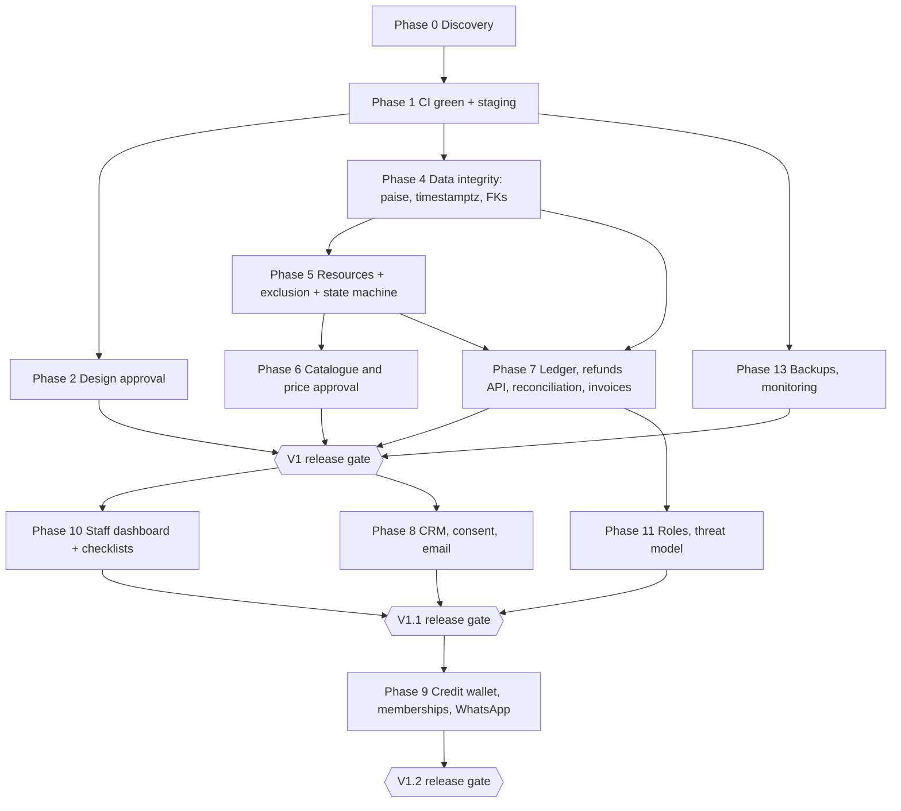

# Development roadmap: dependencies and phase plan

**Date:** 2026-11-23. **Phase:** 0. **Status:** Proposed. Each phase starts only after the owner approves the previous gate (V4-L11).

Phase numbers follow the V4.0 prompt. Because much of V1 already exists, most phases are **hardening and gap closure**, not new builds. Size is relative effort (S, M, L), not a date.

## 1. External dependencies

| Dependency | Needed by | Owner action | Status |
|---|---|---|---|
| Skedda audit Reports 1–12, or a written waiver | Gate 0, Phase 2 | Upload to `docs/reference/` or waive (MD-01) | Missing |
| Owner answers to P0 decisions | Gate 0 | Reply to `MISSING-DECISIONS.md` | Pending |
| Staging Supabase project | Phase 1 | Approve creation (MD-13) | Pending |
| Razorpay account with **test** keys | Phase 7 tests | Create account; add keys in Vercel env, never in chat (MD-18) | Missing |
| Razorpay live keys | V1 launch | After KYC | Missing |
| GSTIN and invoice details | Phase 7 | MD-08 | Missing |
| WhatsApp Business provider | Phase 9 (V1.2) | MD-10 | Missing |
| Email (Resend) key | Phase 8 | Create account | Missing |
| Recording storage | Phase 10 | MD-11 | Missing |
| Domain name | V1 launch | Buy domain | Missing |
| Advocate approval of policy pack | V1 launch | Legal review | Pending |
| Theatre screening licences | Opening the Legal Gate | Licences | Pending |
| Venue photography | Phase 2 | Photoshoot | Missing |

## 2. Internal dependency graph

## 3. Phase plan

| Phase | Scope | Requirements closed | Size | Release | Gate criteria |
|---|---|---|---|---|---|
| **0** | Discovery and documentation (this set) | — | — | — | Skedda doc or waiver; P0 decisions; owner approval |
| **1** | Fix F-01, F-02 (CI green). Staging DB for Preview (F-04). Unit and integration test layers (Vitest). Concurrency test: 50 parallel holds → exactly 1 succeeds. | NFR-10, NFR-03, SEC-09 prep | S | V1 | CI green on 3 consecutive pushes; Preview no longer touches production |
| **2** | Design approval: owner review, six-breakpoint and axe checks, photography in | WEB-05, WEB-06, NFR-06, WEB-07 (if doc supplied) | M | V1 | Owner signs off screens |
| **3** | Customer portal gaps: receipts, my-bookings files, reschedule rule as approved | CUS-03, CUS-05, PAY-09 | S | V1 | e2e for each |
| **4** | Data integrity: money to paise (two-step), `timestamptz`, FKs for resource and package, pricing snapshot lines | NFR-07, NFR-08, FIN-02 | L | V1 | Backfill verified by totals checksum before and after; rollback rehearsed on staging |
| **5** | Resources as first-class (equipment, operators); `booking_resources` + `btree_gist` exclusion; central state machine with Draft, Held, Hold Expired, Payment Failed | BKG-03, BKG-04, BKG-05, OPS-02 | L | V1 | Direct-SQL overlap rejected; transition table tested exhaustively |
| **6** | Catalogue and price approval; settings for tax, advance, hold, tiers | BR-03..07, BR-13, BR-14, ADM-05, WEB-02 | S | V1 | Owner approves prices in admin |
| **7** | Ledger in paise; Razorpay refunds API (full and partial); reconciliation job; GST invoices; late-capture handling | FIN-01, FIN-03, FIN-04, FIN-05, PAY-05, PAY-06, PAY-07 | L | V1 (refunds API may move to V1.1 per V4) | Ledger balances to zero; test-mode end-to-end with real Razorpay test keys |
| **13** | Backups verified, restore drill, uptime and error monitoring, alerting on webhook failures | NFR-04, NFR-05 | S | V1 | Restore drill documented with timings |
| **V1 gate** | V4 Phase 12 release list: no double booking, no unverified confirmation, no duplicate payment, CI green, policy approved | NFR-09 | — | V1 | All P0 rows in the RTM Tested; owner approval |
| **8** | CRM: preferences, consent records with timestamps, anonymisation; email notifications | CRM-01, CRM-02, CRM-04, CRM-05 | M | V1.1 | Anonymise keeps finance records |
| **10** | Staff dashboard; preparation, equipment and reset checklists; recording delivery with retention | OPS-03, OPS-04, OPS-06 | M | V1.1 | Operator sees only assigned bookings |
| **11** | 8-role model with permission table; threat model `SECURITY-AND-PRIVACY.md`; bootstrap password to break-glass | SEC-02, SEC-03, SEC-08, SEC-09 | M | V1.1 | Every role denied outside its permissions (tests) |
| **9** | Credit wallet ledger (fixes the race); pay with credits; memberships; WhatsApp templates | CRD-01..03, CUS-06, CRM-03 | M | V1.2 | Concurrent consumption cannot overdraw |
| **V2** | Out of scope for now (V4 release mapping) | — | — | V2 | — |

## 4. Order of work after approval

1. Phase 1 (CI green, staging). Nothing else ships while CI is red.
2. Phases 4 and 13 in parallel (data integrity, backups), because every later phase depends on correct money and time.
3. Phases 5, 6, 7, then 2 and 3 as design approval allows.
4. V1 gate, then V1.1 phases, then V1.2.

Every phase ends with the V4 session report (current phase, work completed, files created and modified, tests executed with results, **CI status**, known issues, pending dependencies, security concerns, next actions).
