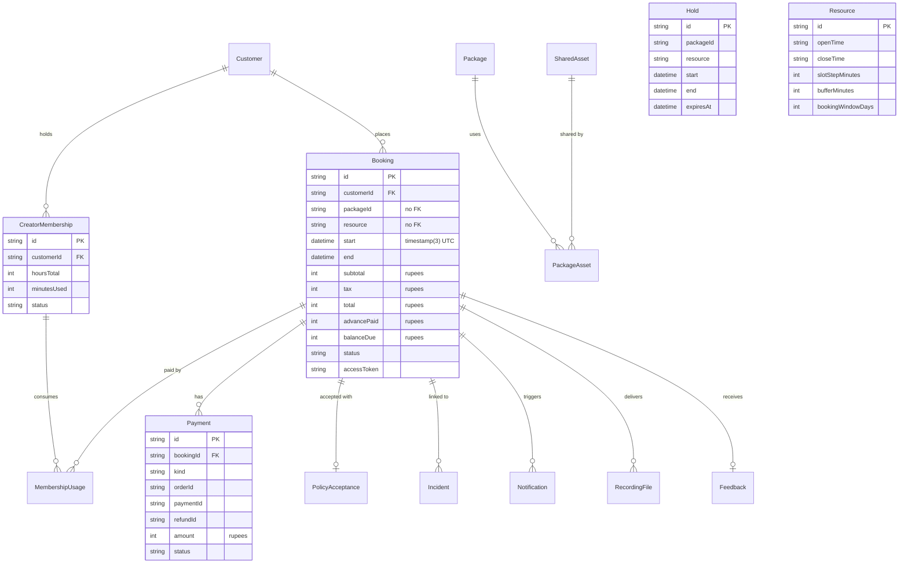
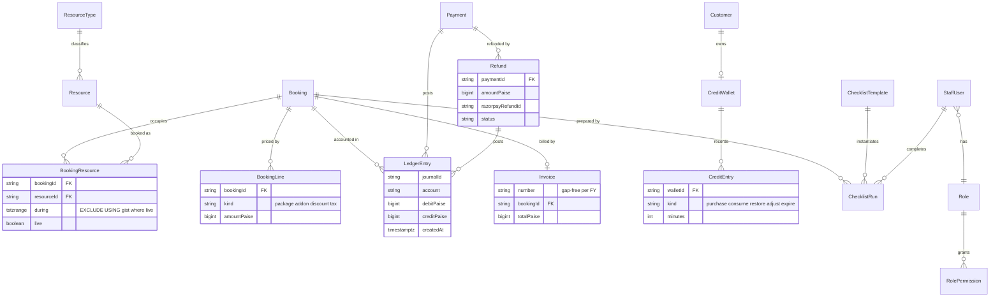

# Entity-relationship diagram

**Date:** 2026-11-23. **Phase:** 0.
- §1 is **Verified** from `prisma/schema.prisma` (30 models, schema `thirdspace`).
- §3 is **Proposed** and needs approval (MD-14, MD-15).

## 1. Current model (Verified)

Only foreign-key relations are drawn. `Booking.packageId`, `Booking.resource`, `Booking.titleId` and `Hold.resource` are **plain strings without foreign keys**. This is a gap noted in §2.

**Models without relations** (stand-alone tables): `Hold`, `SlotBlock`, `PendingOrder`, `Lead`, `OtpCode`, `AuditLog`, `EventCount`, `Title`, `Resource`, `Package`, `AddOn`, `Coupon`, `Setting`, `WebhookEvent`, `Testimonial`, `GalleryImage`, `StaffUser`, `RateLimit`.

## 2. Integrity gaps in the current model (Verified)

| Gap | Effect |
|---|---|
| `Booking.resource`, `Hold.resource` are strings, not FKs to `Resource` | A typo or a renamed resource is not rejected by the database |
| `Booking.packageId` has no FK | Deleting a package leaves orphan references (the name is copied into `packageName`, so history survives) |
| `Booking.addOnIds` is a string array | Add-on prices are not snapshotted per line |
| No overlap constraint | Only the application lock prevents double-booking (R4) |
| Money in rupees | Not paise-exact (R3) |
| `CreatorMembership.minutesUsed` has no CHECK `≤ hoursTotal*60` | Over-consumption possible under a race |

## 3. Proposed additions (Proposed)

**Resource types (Proposed):** theatre room, studio, camera, microphone kit, lighting kit, operator (staff). Every exclusive resource gets rows in `BookingResource`; a booking succeeds only if every required resource is free.
