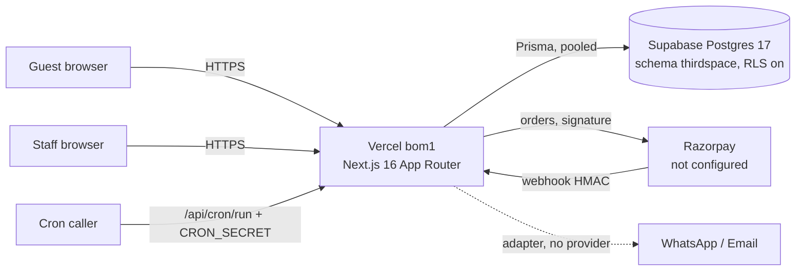
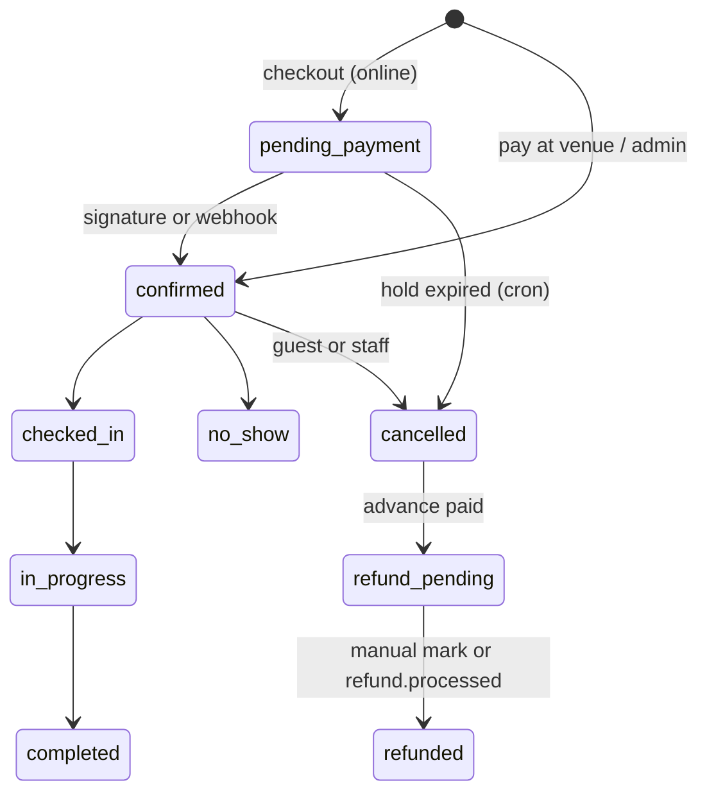
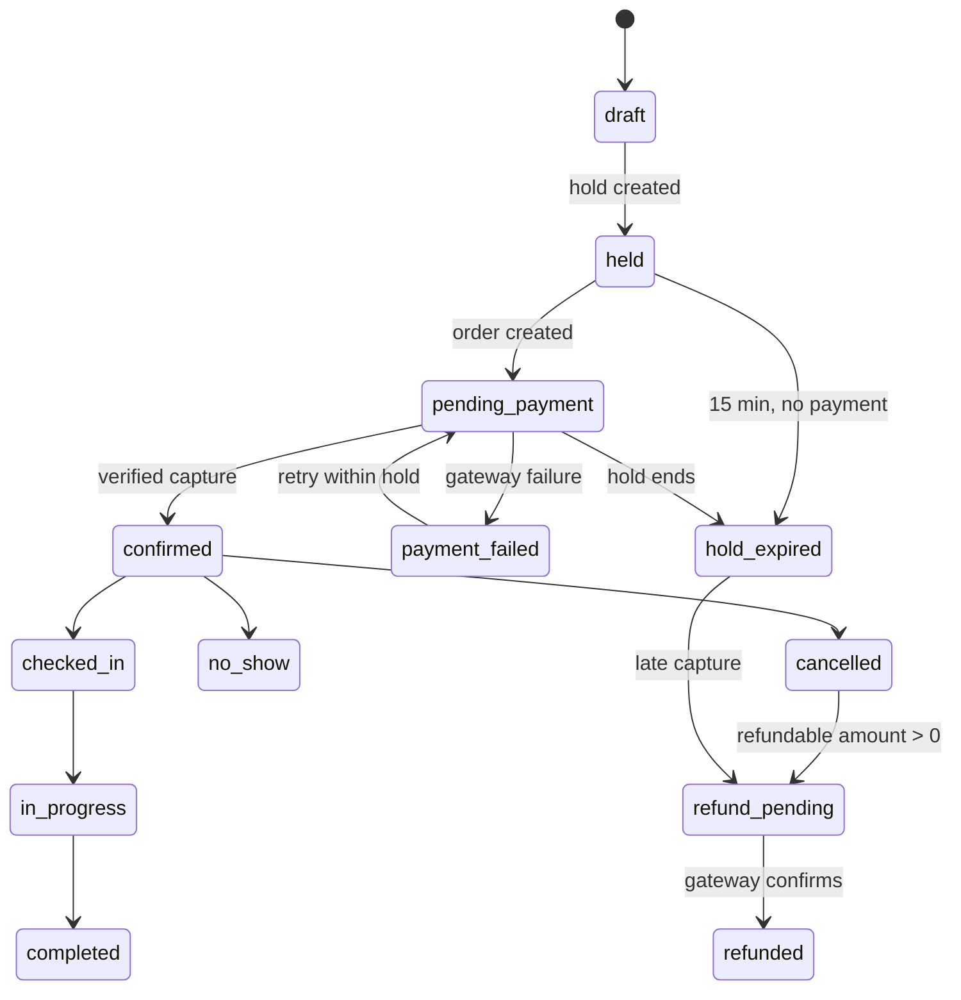

# Technical architecture

**Date:** 2026-11-23. **Phase:** 0. §1–3 describe what exists (Verified from the code). §4–7 are Proposed and need approval.

## 1. Current architecture (Verified)

**Modules inside the one app (modular monolith):**

| Module | Location | Responsibility |
|---|---|---|
| Public site | `src/app/(site)/*`, `src/components/site-*` | Marketing pages, policies, SEO pages |
| Booking flow | `(site)/book`, `api/availability`, `api/calendar`, `api/holds`, `api/checkout*`, `api/coupons` | Availability, holds, checkout |
| Slot engine | `src/server/slots/*` | Free slots, buffers, closures, shared assets, advisory locks |
| Payments | `src/server/payments.ts`, `api/webhooks/razorpay` | Razorpay orders, signature, webhook, idempotency |
| Customer | `customer-auth.ts`, `customer-actions.ts`, `reschedule.ts`, `feedback-actions.ts` | Accounts, my bookings, reschedule, cancel, feedback |
| Admin | `src/app/admin/(panel)/*`, `src/server/admin/*` | Bookings, calendar, schedule, catalogue, CRM, reports, settings, staff, audit |
| Platform | `audit.ts`, `rate-limit.ts`, `notify.ts`, `otp.ts`, `src/lib/session.ts` | Audit log, rate limits, notifications, sessions |

**Request path for a booking:** availability (server computes) → hold (transaction + advisory lock, 15-minute expiry) → checkout (server re-prices, creates `Booking` as `pending_payment` and a Razorpay order, or confirms as pay-at-venue) → confirm (signature) or webhook → `confirmed`.

## 2. Current booking state machine (Verified)

`Booking.status` is a string. Values used in code: `pending_payment`, `confirmed`, `checked_in`, `in_progress`, `completed`, `no_show`, `cancelled`, `refund_pending`, `refunded`. A slot is occupied when status is in `LIVE_STATUSES` (`confirmed`, `checked_in`, `in_progress`, `completed`) or when an unexpired `Hold` covers it.

Transitions are spread across several server files; there is no single transition function.

## 3. Current payment state (Verified)

`Payment.status`: `created` → `captured` | `failed`; `captured` → `refunded`. `pending` is also allowed by the schema comment. Refunds are not requested from Razorpay by the app; staff mark them, or the `refund.processed` webhook completes them.

## 4. Gap analysis against V4.0

| Area | V4.0 requires | Current | Gap size | Phase |
|---|---|---|---|---|
| Money | Integer paise, ledger | Integer rupees, `Payment` table | Large | 4 |
| Time | Timezone-aware storage | `timestamp(3)` UTC by convention | Medium | 4 |
| Overlap | DB-level exclusion | Advisory locks | Medium | 4–5 |
| Resources | Rooms, equipment, staff as independent resources | 2 `Resource` rows + `SharedAsset` | Medium | 5 |
| States | Draft, Held, Hold Expired, Payment Failed, Refund Pending, central transitions | Partial set, scattered | Medium | 5 |
| Refunds | Razorpay refunds API, full and partial | Manual mark | Medium | 7 (V1.1) |
| Reconciliation | Job comparing orders and payments | None | Medium | 7 |
| Invoices | GST invoices, gap-free numbering | None | Medium | 7 |
| Credits | Wallet ledger | Hours on membership; race | Medium | 9 (V1.2) |
| Staff ops | Staff dashboard, checklists | None | Medium | 10 (V1.1) |
| Roles | 8 roles, permission matrix | 5 roles, checks in code | Small | 11 |
| Testing | Unit, integration, concurrency, e2e | e2e only (last local run: 59 passed, 18 skipped) | Medium | Every phase |
| Environments | Dev, staging, production | Production only; Preview shares prod DB | Medium | 1 / 13 |
| Operations | Backups tested, monitoring, alerting | Unknown / none | Medium | 13 |
| Security | Threat model | None | Small | 11 |

## 5. Target booking state machine (Proposed)

One function `transition(booking, event, actor)` will own every change. It checks the allowed edge, writes the audit entry and creates the ledger entries in the same transaction.

## 6. Target payment and ledger model (Proposed)

- `payments`: one row per Razorpay payment (gateway record, paise).
- `ledger_entries`: double-entry lines (`account`, `debit_paise`, `credit_paise`, `booking_id`, `payment_id`, `refund_id`), grouped by `journal_id`. Rows are never updated or deleted. Every journal balances (CHECK via trigger).
- `refunds`: requested amount, Razorpay refund id, status (`requested`, `processed`, `failed`).
- Reconciliation job: every 15 minutes, fetch orders created in the last 48 hours from Razorpay and repair missed captures. Discrepancies go to an admin queue.

## 7. Data integrity changes (Proposed)

| Change | How | Risk |
|---|---|---|
| Paise | Add `*_paise` columns, backfill ×100, switch reads, drop rupee columns in a later release | Two-step to allow rollback |
| `timestamptz` | `ALTER COLUMN ... TYPE timestamptz USING col AT TIME ZONE 'UTC'` | Brief table lock; small tables today |
| Exclusion | `CREATE EXTENSION btree_gist`; `booking_resources(resource_id, during tstzrange, live boolean)` with `EXCLUDE USING gist (resource_id WITH =, during WITH &&) WHERE (live)` | Must backfill existing bookings first and check for overlaps |
| Credits | Ledger table plus `SELECT ... FOR UPDATE` on the wallet row | Migrate current balances as opening entries |

## 8. Non-functional design

- **Security:** server-side role checks on every action, Zod validation, rate limits in Postgres, webhook HMAC, secrets only in Vercel env, separate Razorpay test and live keys. Threat model to be written in Phase 11 (`SECURITY-AND-PRIVACY.md`).
- **Observability (Proposed):** error reporting, uptime check on `/` and `/api/availability`, alert on webhook failures and reconciliation discrepancies.
- **Environments (Proposed):** local (Docker or local Postgres), staging (separate Supabase project, Vercel Preview), production. Migrations reviewed before reaching production.
